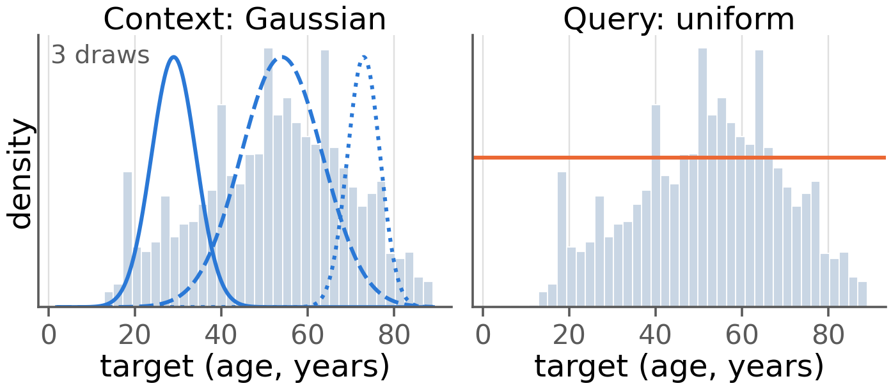
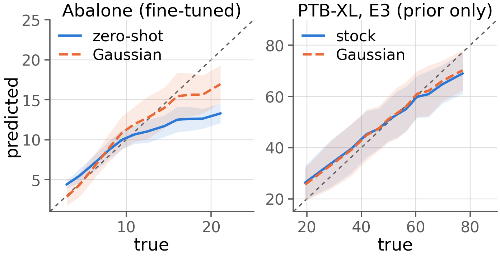

# Experiment Results --- Gaussian Context Sampling for Imbalanced Regression

**Compiled:** 11 November 2026\
**Source:** Completed experiment-results report, checked against
`paper_completion_plan.md`\
**Seeds:** 0--4 (five seeds per reported experiment)\
**Reporting:** mean ± population standard deviation across seeds; lower
is better.

------------------------------------------------------------------------

## 1. Repository and evaluation overview

### 1.1 Required repository files

| Deliverable | Status |
|---|---|
| `results/REPO_MAP.md` | Present |
| `results/STATUS.md` | Present |
| `results/preds/*.csv` | 1,161 prediction files |
| `results/metrics/*.csv` | 15 files, including `all_metrics.csv` and `significance.csv` |
| `paper/tables/table1a.tex` | Present |
| `paper/tables/table1b.tex` | Present |
| `paper/tables/table2.tex` | Present |
| `paper/tables/table3.tex` | Present |
| `paper/figs/fig1_method.pdf` | Present |
| `paper/figs/fig2_pred_vs_true.pdf` | Present |
| `paper/main.tex` | Compiles to 3 pages |
| `paper/RESULTS_SUMMARY.md` | Present |

### 1.2 Evaluation protocol

**PTB-XL age bands**

-   Young: age \< 30
-   Middle: 30 ≤ age \< 60
-   Old: age ≥ 60

**Metrics**

-   Per-band MAE.
-   Natural MAE: MAE on the official test split with its natural age
    distribution.
-   Band-macro MAE: arithmetic mean of the three per-band MAEs.
-   Balanced MAE: the repository's existing DIR evaluation, calculated
    on a resampled, approximately age-balanced test set.
-   GM: `exp(mean(log(abs(y_pred - y_true) + 1e-8)))`.

**Tabular benchmarks**

-   Many-shot: target bins with more than 100 training samples.
-   Few-shot: target bins with fewer than 20 training samples.
-   Medium-shot: all remaining bins.
-   Overall MAE and GM are computed on the same test set as the
    shot-region metrics.

**Implementation and reporting**

-   Metrics are computed from saved prediction files using
    `eval/compute_metrics.py`.
-   Fine-tuning uses training data; learning-rate selection and early
    stopping use validation data.
-   Final reported metrics use five seeds.
-   Standard deviations in the tables below use the population
    convention (`ddof=0`).

### 1.3 Dataset and test-set details

| Dataset | Total samples | Features | Evaluation protocol | Test samples |
|---|---|---|---|---|
| Abalone | 4,177 | 8 | DIR | 382 |
| Communities | 1,994 | 122 | DIR | 300 |
| Wine Quality White | 4,898 | 11 | DIR | 319 |
| PTB-XL embeddings | 9,483 | 128 | Official fixed split | 954 |

PTB-XL official test-set age distribution:

  Age band              Test samples   Percentage
  ------------------- -------------- ------------
  Young (\<30)                   125        13.1%
  Middle (30--\<60)              526        55.1%
  Old (≥60)                      303        31.8%

### 1.4 Data-hygiene finding

The DIR PTB-XL protocol re-partitions the concatenation of the official
training, validation and test records. The encoders were trained on the
official training split, so records from that training split appear in
the DIR test set.

  Seed     DIR test samples   Already seen by encoder
  ------ ------------------ -------------------------
  0                   1,499             1,207 (80.5%)
  1                   1,499             1,229 (82.0%)

**Decision:** PTB-XL headline results use the official `fixed` test
split of 954 records, which is not used to train the encoders. DIR
results are retained only where explicitly labelled as balanced/DIR
results; they must not be presented as clean test performance.

The DIR protocol's balanced MAE is therefore not interchangeable with
natural MAE or band-macro MAE.

------------------------------------------------------------------------

## 2. Experiment completion status

| Task | Required experiment | Status |
|---|---|---|
| A | ResNet Vanilla and RankSim + CONR, five seeds, unified PTB-XL split | Complete |
| B1 | TabICL v2 target-balanced synthetic-prior training, 3,000 steps, three tabular datasets, five seeds | Complete |
| B2 | TabPFN-2.5 target-balanced fine-tuning on Abalone, five seeds | Complete |
| C | Five-seed tabular and PTB-XL evaluations; missing metrics | Complete |
| D | Paired bootstrap significance tests and per-seed win counts | Complete, with one required metric mismatch noted in Section 6 |

### Task A --- ResNet baselines

The two ResNet baselines were retrained using the same official PTB-XL
partition as the encoder experiments. Record IDs were compared to verify
the split.

  Model                         Natural MAE
  ------------------------- ---------------
  ResNet Vanilla              7.477 ± 0.085
  ResNet + RankSim + CONR     7.551 ± 0.138

The complete per-band and other available metrics are included in Table
2. The requested existing balanced MAE is not shown in the generated
Table 2; see Section 5.

### Task B --- Target-balanced context control

The `target_balanced` sampler was implemented using 50 equal-width
target bins and sampling probability proportional to the inverse count
of each row's bin.

**B1:** Completed for TabICL v2 on Abalone, Communities and Wine Quality
White, using 3,000 additional synthetic-prior training steps and five
seeds. Results are included in Table 1a.

**B2:** Completed for TabPFN-2.5 on Abalone. Results are included in
Table 1b.

Sampler verification on a skewed candidate pool:

  Sampling mode       Rare-target share in context
  ----------------- ------------------------------
  Pool baseline                             0.0385
  Uniform                                   0.0382
  Target-balanced                           0.0785
  Gaussian                                  0.0000

### Task C --- Five-seed evaluations

-   Tabular TabICL: zero-shot, uniform-context, Gaussian-context and
    target-balanced-context results were evaluated.
-   PTB-XL TabICL: E1, E2, E3 and E4 were evaluated with stock and
    Gaussian-context prediction heads.
-   PTB-XL TabPFN: E2 with stock TabPFN-2.5 and E2 with
    Gaussian-fine-tuned TabPFN-2.5 were evaluated under the official
    fixed split.

Encoder definitions:

  Encoder   Training procedure
  --------- ------------------------------------------------
  E1        Supervised L1 age-regression loss
  E2        Trained through frozen stock TabPFN-2.5
  E3        Trained through frozen stock TabICL
  E4        Trained through frozen Gaussian-context TabICL

### Task D --- Significance tests

Paired bootstrap tests use 10,000 resamples and report 95% confidence
intervals for ΔMAE, where:

`ΔMAE = MAE(method) − MAE(reference)`

Negative values favour the method. Per-seed win counts are reported out
of five.

------------------------------------------------------------------------

## 3. Table 1a --- TabICL synthetic-prior continued training

DIR protocol; five seeds. Values are mean ± standard deviation.

### Abalone

| Context | Many | Medium | Few | Overall | GM |
|---|---|---|---|---|---|
| Zero-shot | 1.146 ± 0.081 | 2.595 ± 0.031 | 6.219 ± 0.030 | 2.956 ± 0.038 | 1.649 ± 0.085 |
| Uniform | 1.148 ± 0.082 | **2.578 ± 0.031** | **6.189 ± 0.031** | **2.943 ± 0.039** | **1.645 ± 0.077** |
| Target-balanced | 1.163 ± 0.054 | 3.226 ± 0.027 | 7.233 ± 0.032 | 3.432 ± 0.023 | 1.989 ± 0.064 |
| Gaussian | **1.128 ± 0.087** | 2.618 ± 0.024 | 6.385 ± 0.037 | 3.000 ± 0.028 | 1.665 ± 0.075 |

### Communities

| Context | Many | Medium | Few | Overall | GM |
|---|---|---|---|---|---|
| Zero-shot | 0.0587 ± 0.0013 | **0.1680 ± 0.0054** | 0.2552 ± 0.0083 | 0.1598 ± 0.0040 | 0.0898 ± 0.0068 |
| Uniform | 0.0585 ± 0.0014 | 0.1683 ± 0.0055 | **0.2549 ± 0.0082** | **0.1598 ± 0.0040** | **0.0896 ± 0.0072** |
| Target-balanced | **0.0514 ± 0.0023** | 0.2126 ± 0.0059 | 0.3552 ± 0.0024 | 0.2047 ± 0.0020 | 0.1135 ± 0.0025 |
| Gaussian | 0.0577 ± 0.0015 | 0.1737 ± 0.0066 | 0.2854 ± 0.0037 | 0.1708 ± 0.0031 | 0.0937 ± 0.0042 |

### Wine Quality White

| Context | Many | Medium | Few | Overall | GM |
|---|---|---|---|---|---|
| Zero-shot | **0.335 ± 0.008** | **1.195 ± 0.060** | **2.453 ± 0.024** | **0.785 ± 0.020** | **0.256 ± 0.008** |
| Uniform | 0.337 ± 0.009 | 1.199 ± 0.059 | 2.456 ± 0.025 | 0.787 ± 0.019 | 0.267 ± 0.009 |
| Target-balanced | 0.345 ± 0.009 | 1.275 ± 0.055 | 2.535 ± 0.019 | 0.825 ± 0.019 | 0.285 ± 0.013 |
| Gaussian | 0.349 ± 0.011 | 1.280 ± 0.051 | 2.517 ± 0.022 | 0.828 ± 0.018 | 0.353 ± 0.010 |

**Result:** Gaussian context in synthetic-prior continued training does
not improve few-shot or overall MAE over uniform context on any of the
three tabular datasets. Target-balanced context also performs worse than
the uniform control.

------------------------------------------------------------------------

## 4. Table 1b --- TabPFN-2.5 per-dataset fine-tuning

DIR protocol; five seeds. Values are mean ± standard deviation.

### Abalone

| Fine-tuning method | Many | Medium | Few | Overall |
|---|---|---|---|---|
| Zero-shot | **1.170 ± 0.077** | 2.569 ± 0.028 | 6.163 ± 0.040 | 2.942 ± 0.029 |
| Uniform | 1.208 ± 0.086 | 2.357 ± 0.105 | 5.767 ± 0.217 | 2.786 ± 0.108 |
| Gaussian | 1.584 ± 0.145 | **1.392 ± 0.094** | **4.127 ± 0.151** | **2.202 ± 0.062** |
| Target-balanced | 1.188 ± 0.082 | 2.563 ± 0.026 | 6.092 ± 0.148 | 2.929 ± 0.039 |

### Communities

| Fine-tuning method | Many | Medium | Few | Overall |
|---|---|---|---|---|
| Zero-shot | **0.0592 ± 0.0015** | 0.1677 ± 0.0049 | 0.2577 ± 0.0053 | 0.1606 ± 0.0035 |
| Uniform | 0.0597 ± 0.0016 | 0.1678 ± 0.0051 | 0.2538 ± 0.0062 | 0.1596 ± 0.0026 |
| Gaussian | 0.0646 ± 0.0031 | **0.1617 ± 0.0042** | **0.2348 ± 0.0012** | **0.1530 ± 0.0020** |

### Wine Quality White

| Fine-tuning method | Many | Medium | Few | Overall |
|---|---|---|---|---|
| Zero-shot | 0.427 ± 0.013 | 1.432 ± 0.022 | 2.455 ± 0.027 | 0.926 ± 0.011 |
| Uniform | **0.370 ± 0.019** | 1.295 ± 0.023 | 2.375 ± 0.025 | 0.837 ± 0.011 |
| Gaussian | 0.391 ± 0.038 | **1.138 ± 0.055** | **2.250 ± 0.104** | **0.783 ± 0.031** |

**Result:** Gaussian fine-tuning improves few-shot MAE and overall MAE
over uniform fine-tuning on all three datasets.

| Dataset | Few-shot MAE: Uniform → Gaussian | Overall MAE: Uniform → Gaussian |
|---|---|---|
| Abalone | 5.767 → 4.127 (−28.4%) | 2.786 → 2.202 (−21.0%) |
| Communities | 0.2538 → 0.2348 (−7.5%) | 0.1596 → 0.1530 (−4.1%) |
| Wine Quality White | 2.375 → 2.250 (−5.3%) | 0.837 → 0.783 (−6.5%) |

**Trade-off:** Many-shot MAE becomes worse under Gaussian fine-tuning on
all three datasets. The improvement in rare-target regions therefore
comes with a cost in frequent-target regions.

------------------------------------------------------------------------

## 5. Table 2 --- PTB-XL age prediction

Official fixed test split; five seeds. MAE values are in years.

**Important:** The generated report provides band-macro MAE, not the
existing DIR balanced MAE requested in the original Table 2
specification. Both are different metrics. Band-macro is included below
as reported; the requested balanced column is marked `TODO` rather than
being replaced with band-macro.

| Model | \<30 | 30--60 | ≥60 | Natural | Band-macro | Balanced (requested) | GM |
|---|---|---|---|---|---|---|---|
| ResNet Vanilla | 8.533 ± 0.215 | **6.784 ± 0.169** | 8.244 ± 0.558 | 7.477 ± 0.085 | 7.854 ± 0.097 | TODO | 4.863 ± 0.081 |
| ResNet + RankSim + CONR | 8.399 ± 0.504 | 6.847 ± 0.174 | 8.425 ± 0.317 | 7.551 ± 0.138 | 7.890 ± 0.123 | TODO | 4.905 ± 0.110 |
| E2 + stock TabPFN-2.5 | 7.659 ± 0.013 | 7.246 ± 0.006 | 7.628 ± 0.010 | 7.421 ± 0.003 | 7.511 ± 0.006 | TODO | 4.728 ± 0.015 |
| E2 + Gaussian TabPFN-2.5 | 7.663 ± 0.017 | 7.244 ± 0.006 | 7.629 ± 0.010 | 7.421 ± 0.003 | 7.512 ± 0.007 | TODO | 4.731 ± 0.014 |
| E3 + stock TabICL | 7.600 ± 0.020 | 7.152 ± 0.005 | 7.601 ± 0.006 | **7.353 ± 0.002** | 7.451 ± 0.005 | TODO | **4.716 ± 0.038** |
| E3 + Gaussian TabICL | **7.059 ± 0.053** | 7.849 ± 0.061 | **7.342 ± 0.053** | 7.585 ± 0.017 | **7.417 ± 0.017** | TODO | 4.903 ± 0.058 |

**Important interpretation notes**

-   E3 + Gaussian TabICL improves the young and old bands but worsens
    the middle band.
-   Compared with E3 + stock TabICL, natural MAE worsens from 7.353 to
    7.585 years.
-   Band-macro MAE improves slightly from 7.451 to 7.417 years. These
    two aggregate metrics therefore give different conclusions.
-   E2 + Gaussian TabPFN-2.5 is byte-identical to the stock model for
    all five seeds under the clean fixed protocol. Validation-based
    early stopping returned the original checkpoint; this row is not
    evidence of a successful Gaussian fine-tuning run.
-   RankSim + CONR does not improve on the vanilla ResNet baseline.

------------------------------------------------------------------------

## 6. Table 3 --- Encoder training versus prediction head

Natural MAE uses the official fixed test split. Balanced MAE uses the
DIR split and is affected by the encoder-training/test-record overlap
described in Section 1.4. Values are mean ± standard deviation, in
years.

| Encoder | Natural: Stock head | Natural: Gaussian head | Balanced/DIR: Stock head | Balanced/DIR: Gaussian head |
|---|---|---|---|---|
| E1 --- supervised L1 | 7.428 ± 0.008 | 7.654 ± 0.041 | 7.330 ± 0.067 | 7.162 ± 0.070 |
| E2 --- through TabPFN | 7.428 ± 0.004 | 7.648 ± 0.015 | 7.258 ± 0.090 | 7.108 ± 0.080 |
| E3 --- through stock TabICL | **7.353 ± 0.002** | **7.585 ± 0.017** | **7.152 ± 0.090** | **7.042 ± 0.120** |
| E4 --- through Gaussian TabICL | 7.469 ± 0.004 | 7.617 ± 0.007 | 7.384 ± 0.080 | 7.392 ± 0.108 |

**Result:** E3 is the best encoder across the four reported columns. The
Gaussian prediction head improves the DIR balanced metric for E1, E2 and
E3, but worsens natural MAE for all four encoders. The DIR improvements
should be interpreted cautiously because the DIR test split contains
records seen during encoder training.

------------------------------------------------------------------------

## 7. Significance tests

Paired bootstrap: 10,000 resamples; 95% confidence intervals. Negative
ΔMAE favours the first-listed method. Win counts are out of five seeds.

### 7.1 PTB-XL comparisons

| Comparison | Metric | ΔMAE | 95% CI | Significant? | Wins |
|---|---|---|---|---|---|
| E3 Gaussian TabICL vs E3 stock TabICL | Overall | +0.218 | \[+0.130, +0.308\] | Yes | 0/5 |
|  | Young | −0.551 | \[−0.699, −0.403\] | Yes | 5/5 |
|  | Middle | +0.683 | \[+0.586, +0.785\] | Yes | 0/5 |
|  | Old | −0.272 | \[−0.454, −0.087\] | Yes | 5/5 |
| E2 Gaussian TabPFN vs E2 stock TabPFN | Overall | 0.000 | \[0.000, 0.000\] | No | 0/5 |
|  | Young | 0.000 | \[0.000, 0.000\] | No | 0/5 |
|  | Middle | 0.000 | \[0.000, 0.000\] | No | 0/5 |
|  | Old | 0.000 | \[0.000, 0.000\] | No | 0/5 |
| Best ICL (E3 Gaussian TabICL) vs ResNet Vanilla | Overall | +0.401 | \[+0.184, +0.620\] | Yes | 1/5 |
|  | Young | −1.337 | \[−1.890, −0.744\] | Yes | 5/5 |
|  | Middle | +1.369 | \[+1.106, +1.633\] | Yes | 0/5 |
|  | Old | −0.561 | \[−0.953, −0.174\] | Yes | 5/5 |

The E2 Gaussian TabPFN comparison has zero difference because the
Gaussian fine-tuning run returned the stock checkpoint under the clean
split.

### 7.2 Tabular comparison: Gaussian versus target-balanced

**Metric mismatch:** The original plan requests significance tests on
the few-shot region. The generated significance results below report
overall MAE instead. The few-shot bootstrap results are therefore still
required.

| Dataset | Reported metric | ΔMAE: Gaussian − target-balanced | 95% CI | Significant? | Wins |
|---|---|---|---|---|---|
| Abalone | Overall | −0.432 | \[−0.487, −0.376\] | Yes | 5/5 |
| Communities | Overall | −0.034 | \[−0.039, −0.028\] | Yes | 5/5 |
| Wine Quality White | Overall | +0.003 | \[−0.007, +0.013\] | No | 0/5 |

These overall comparisons do not satisfy the plan's requested few-shot
significance analysis. They are retained as supplementary results, not
as a substitute.

------------------------------------------------------------------------

## 8. Figures

| Figure | Required content | Status |
|---|---|---|
| Fig. 1 --- Method schematic | Target histogram with multiple Gaussian context-sampling curves; queries sampled uniformly over target range | Complete |
| Fig. 2 --- Prediction vs truth | Abalone: TabICL zero-shot vs Gaussian; PTB-XL: E3 stock vs Gaussian TabICL; binned prediction means, ±1 SD shading and y=x line | Complete |

### Figure 1 --- method schematic

### Figure 2 --- prediction against truth

Files:

-   `figs/fig1_method.png`, `figs/fig2_pred_vs_true.png` --- 7.2 in, 200 dpi,
    for reading on the web. A PDF cannot be displayed inline in Markdown.
-   `paper/figs/fig1_method.pdf`, `paper/figs/fig2_pred_vs_true.pdf` --- 3.3 in
    single-column vector, 300 dpi, for the paper.

Both are produced by one script, `eval/make_figures.py`, so the two renders cannot
drift apart. The palette is colour-blind safe and the two series also differ in line
style, so the figures survive greyscale printing. Fig. 2 uses seed-averaged
predictions; its PTB-XL panel uses the clean official fixed split.

------------------------------------------------------------------------

## 9. Paper status

| Requirement | Status |
|---|---|
| `paper/main.tex` created | Complete |
| Venue template used if available; generic two-column template otherwise | Reported as complete |
| Tables 1a, 1b, 2 and 3 included | Complete |
| Figures 1 and 2 included | Complete |
| Paper compiles to four pages or fewer, excluding references | Complete --- 3 pages |
| `paper/RESULTS_SUMMARY.md` generated | Complete |

------------------------------------------------------------------------

## 10. Results summary

1.  **Table 1a:** Gaussian context sampling during TabICL
    synthetic-prior continued training does not improve few-shot or
    overall MAE over uniform context on Abalone, Communities or Wine
    Quality White; target-balanced context performs worse overall.
2.  **Table 1b:** Gaussian per-dataset TabPFN-2.5 fine-tuning improves
    few-shot and overall MAE over uniform fine-tuning on all three
    tabular datasets, while increasing many-shot MAE on all three.
3.  **Table 2:** On PTB-XL, E3 + Gaussian TabICL improves young- and
    old-age-band MAE but worsens middle-band and natural MAE relative to
    E3 + stock TabICL. The requested balanced-MAE column remains to be
    supplied.
4.  **Table 3:** E3 gives the best encoder results among E1--E4;
    Gaussian heads improve DIR balanced MAE for E1--E3 but worsen
    natural MAE for every encoder.

------------------------------------------------------------------------

## 11. Limitations and outstanding items

### Limitations supported by the results

-   The DIR PTB-XL split leaks encoder-training records into its test
    set. Clean headline results must use the official fixed split.
-   Under the fixed split, seed variation measures run-to-run variation,
    not variation across different data splits.
-   E3, E4 and E5 encoders reached their best validation score at the
    first evaluation (step 200) and degraded afterwards; the encoder
    comparison is not a comparison of fully converged models.
-   E2 + Gaussian TabPFN on PTB-XL reverted to the stock checkpoint
    under early stopping.
-   The Abalone target-balanced TabPFN run reverted to the stock
    checkpoint in 14 of 15 learning-rate/seed cells.
-   Target-balanced sampling has limited leverage in the TabICL prior
    because the sampled context already contains 79--81% of the
    available rows.
-   Wine Quality White few-shot evaluation contains only 19 test
    samples.
-   ResNet retraining used one GPU; batch-normalisation statistics may
    therefore differ from the original two-GPU run.
-   B2 target-balanced TabPFN fine-tuning was run on Abalone only, as
    specified in the plan.

### Items that still need attention before calling every requirement complete

1.  **Table 2 balanced MAE:** The generated table reports band-macro
    MAE, not the requested existing balanced MAE. Add the balanced
    values for all six models, or document why a valid value cannot be
    produced. Do not relabel band-macro as balanced.
2.  **Task D tabular significance:** Re-run the
    Gaussian-versus-target-balanced paired bootstrap on the few-shot
    region for each tabular dataset. The currently reported significance
    values are for overall MAE.
3.  **Table 2 footnote:** Include the relevant bootstrap confidence
    intervals once the final table is regenerated with the required
    balanced column.
4.  **Data-hygiene documentation:** Keep the DIR leakage clearly
    disclosed in `results/STATUS.md` and `results/REPO_MAP.md`; do not
    use DIR results as clean PTB-XL test performance.

------------------------------------------------------------------------

## 12. Final deliverables checklist

| Deliverable from original plan | Status |
|---|---|
| `results/REPO_MAP.md` | Present |
| `results/STATUS.md` | Present |
| `results/preds/*.csv` and `results/metrics/*.csv` | Present |
| `paper/tables/table1a.tex` | Present |
| `paper/tables/table1b.tex` | Present |
| `paper/tables/table2.tex` | Present --- balanced-MAE requirement needs checking |
| `paper/tables/table3.tex` | Present |
| `paper/figs/fig1_method.pdf` | Present |
| `paper/figs/fig2_pred_vs_true.pdf` | Present |
| `paper/main.tex` compiling to ≤4 pages | Complete --- 3 pages |
| `paper/RESULTS_SUMMARY.md` | Present |

**Overall:** The experiment runs, prediction files, main tables, figures
and paper compilation are reported as complete. The generated report
does not yet demonstrate completion of two exact requirements: balanced
MAE in Table 2 and few-shot-region significance tests for the tabular
Gaussian-versus-target-balanced comparison.