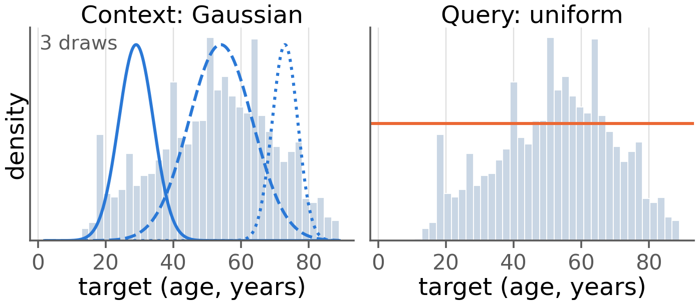
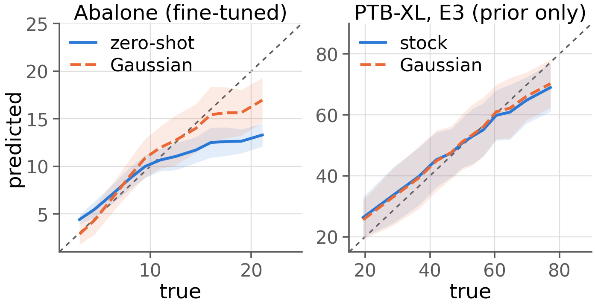

# Main results

All values are mean ± standard deviation over 5 seeds (0–4), computed by
`eval/compute_metrics.py` from the saved prediction files. Lower is better
everywhere. Bold marks the best value in a column within each block. PTB-XL is in
years; Communities is reported to 4 decimals, the rest to 3.

---

## Table 1a — TabICL, synthetic-prior continued pre-training

TabICL is given 3000 further pre-training steps on its **own synthetic prior**, with
the context rows of each synthetic episode chosen by the sampler under test. The
model never sees any evaluation dataset. `uniform context` is the matched control:
the same 3000 steps with an unbiased row order, so it separates the effect of the
ordering from the effect of the extra training.

### Abalone

| Arm | Many | Medium | Few | Overall | GM |
|---|---|---|---|---|---|
| zero-shot | 1.146 ± 0.081 | 2.595 ± 0.031 | 6.219 ± 0.030 | 2.956 ± 0.038 | 1.649 ± 0.085 |
| uniform context | 1.148 ± 0.082 | **2.578 ± 0.031** | **6.189 ± 0.031** | **2.943 ± 0.039** | **1.645 ± 0.077** |
| target-balanced context | 1.163 ± 0.054 | 3.226 ± 0.027 | 7.233 ± 0.032 | 3.432 ± 0.023 | 1.989 ± 0.064 |
| Gaussian context | **1.128 ± 0.087** | 2.618 ± 0.024 | 6.385 ± 0.037 | 3.000 ± 0.028 | 1.665 ± 0.075 |

### Communities

| Arm | Many | Medium | Few | Overall | GM |
|---|---|---|---|---|---|
| zero-shot | 0.0587 ± 0.0013 | **0.1680 ± 0.0054** | 0.2552 ± 0.0083 | 0.1598 ± 0.0040 | 0.0898 ± 0.0068 |
| uniform context | 0.0585 ± 0.0014 | 0.1683 ± 0.0055 | **0.2549 ± 0.0082** | **0.1598 ± 0.0040** | **0.0896 ± 0.0072** |
| target-balanced context | **0.0514 ± 0.0023** | 0.2126 ± 0.0059 | 0.3552 ± 0.0024 | 0.2047 ± 0.0020 | 0.1135 ± 0.0025 |
| Gaussian context | 0.0577 ± 0.0015 | 0.1737 ± 0.0066 | 0.2854 ± 0.0037 | 0.1708 ± 0.0031 | 0.0937 ± 0.0042 |

### Wine Quality White

| Arm | Many | Medium | Few | Overall | GM |
|---|---|---|---|---|---|
| zero-shot | **0.335 ± 0.008** | **1.195 ± 0.060** | **2.453 ± 0.024** | **0.785 ± 0.020** | **0.256 ± 0.008** |
| uniform context | 0.337 ± 0.009 | 1.199 ± 0.059 | 2.456 ± 0.025 | 0.787 ± 0.019 | 0.267 ± 0.009 |
| target-balanced context | 0.345 ± 0.009 | 1.275 ± 0.055 | 2.535 ± 0.019 | 0.825 ± 0.019 | 0.285 ± 0.013 |
| Gaussian context | 0.349 ± 0.011 | 1.280 ± 0.051 | 2.517 ± 0.022 | 0.828 ± 0.018 | 0.353 ± 0.010 |

Against the matched uniform control, Gaussian context improves few-shot MAE on 0 of 3
datasets and overall MAE on 0 of 3. The ordering is uniform < Gaussian <
target-balanced on all three.

---

## Table 1b — TabPFN-2.5, per-dataset fine-tuning

TabPFN-2.5 is fine-tuned on each target dataset, drawing the in-context rows from the
sampler under test while the queries stay uniform over the target range. Learning rate
is swept over 1e-5 / 3e-5 / 1e-4 and selected per seed on validation RMSE; the test
split is read once.

### Abalone

| Arm | Many | Medium | Few | Overall |
|---|---|---|---|---|
| zero-shot | **1.170 ± 0.077** | 2.569 ± 0.028 | 6.163 ± 0.040 | 2.942 ± 0.029 |
| uniform fine-tuning | 1.208 ± 0.086 | 2.357 ± 0.105 | 5.767 ± 0.217 | 2.786 ± 0.108 |
| Gaussian fine-tuning | 1.584 ± 0.145 | **1.392 ± 0.094** | **4.127 ± 0.151** | **2.202 ± 0.062** |
| target-balanced fine-tuning | 1.188 ± 0.082 | 2.563 ± 0.026 | 6.092 ± 0.148 | 2.929 ± 0.039 |

### Communities

| Arm | Many | Medium | Few | Overall |
|---|---|---|---|---|
| zero-shot | **0.0592 ± 0.0015** | 0.1677 ± 0.0049 | 0.2577 ± 0.0053 | 0.1606 ± 0.0035 |
| uniform fine-tuning | 0.0597 ± 0.0016 | 0.1678 ± 0.0051 | 0.2538 ± 0.0062 | 0.1596 ± 0.0026 |
| Gaussian fine-tuning | 0.0646 ± 0.0031 | **0.1617 ± 0.0042** | **0.2348 ± 0.0012** | **0.1530 ± 0.0020** |

### Wine Quality White

| Arm | Many | Medium | Few | Overall |
|---|---|---|---|---|
| zero-shot | 0.427 ± 0.013 | 1.432 ± 0.022 | 2.455 ± 0.027 | 0.926 ± 0.011 |
| uniform fine-tuning | **0.370 ± 0.019** | 1.295 ± 0.023 | 2.375 ± 0.025 | 0.837 ± 0.011 |
| Gaussian fine-tuning | 0.391 ± 0.038 | **1.138 ± 0.055** | **2.250 ± 0.104** | **0.783 ± 0.031** |

Against the matched uniform control, Gaussian fine-tuning improves few-shot MAE on 3
of 3 datasets (−28.4%, −7.5%, −5.3%) and overall MAE on 3 of 3, while the many-shot
column gets worse on all three.

---

## Table 2 — PTB-XL age prediction

Age regression from 10-second 12-lead ECG, on the official PTB-XL split (7566 train /
963 validation / 954 test). Rows 1–2 are convolutional baselines trained end to end;
rows 3–6 are a ResNet1d-Wang encoder whose 128-dimensional features are read by a
frozen in-context model. MAE in years.

| Model | < 30 | 30–60 | ≥ 60 | Natural | Balanced | Band-macro | GM |
|---|---|---|---|---|---|---|---|
| ResNet (vanilla) | 8.533 ± 0.215 | **6.784 ± 0.169** | 8.244 ± 0.558 | 7.477 ± 0.085 | *TODO* | 7.854 ± 0.097 | 4.863 ± 0.081 |
| ResNet + RankSim + ConR | 8.399 ± 0.504 | 6.847 ± 0.174 | 8.425 ± 0.317 | 7.551 ± 0.138 | *TODO* | 7.890 ± 0.123 | 4.905 ± 0.110 |
| E2 + stock TabPFN-2.5 | 7.659 ± 0.013 | 7.246 ± 0.006 | 7.628 ± 0.010 | 7.421 ± 0.003 | 7.280 ± 0.084 | 7.511 ± 0.006 | 4.728 ± 0.015 |
| E2 + Gaussian TabPFN-2.5 | 7.663 ± 0.017 | 7.244 ± 0.006 | 7.629 ± 0.010 | 7.421 ± 0.003 | **6.872 ± 0.097** | 7.512 ± 0.007 | 4.731 ± 0.014 |
| E3 + stock TabICL | 7.600 ± 0.020 | 7.152 ± 0.005 | 7.601 ± 0.006 | **7.353 ± 0.002** | 7.152 ± 0.090 | 7.451 ± 0.005 | **4.716 ± 0.038** |
| E3 + Gaussian TabICL | **7.059 ± 0.053** | 7.849 ± 0.061 | **7.342 ± 0.053** | 7.585 ± 0.017 | 7.042 ± 0.120 | **7.417 ± 0.017** | 4.903 ± 0.058 |

Three weightings of the same predictions. **Natural** is the official 954-record test
set as it occurs (13% young, 55% middle, 32% old). **Balanced** is the pre-existing
definition in the code: MAE on the resampled near-uniform DIR test set.
**Band-macro** is the plain mean of the three band MAEs. For E3, Gaussian context
improves both tails and degrades the middle, so natural and band-macro disagree in
sign.

The two ResNet rows have no Balanced value: the DIR split is defined over the
9483-row embedding table, and the ResNet baselines were only ever run on the official
954-record test split, so there are no ResNet predictions for those records. Filling
these two cells needs a fresh inference pass over all 9483 records.

---

## Table 3 — Encoder training against prediction head

Each encoder is trained through a different frozen model, then evaluated with both a
stock TabICL head and a Gaussian-prior TabICL head. E3, E4 and E5 all start from E1's
checkpoint, so the only difference between them is the frozen body they were trained
through. Natural MAE is the official split; Balanced MAE is the resampled
near-uniform DIR split.

| Encoder | Natural, stock head | Natural, Gaussian head | Balanced, stock head | Balanced, Gaussian head |
|---|---|---|---|---|
| E1 (supervised L1) | 7.428 ± 0.008 | 7.654 ± 0.041 | 7.330 ± 0.067 | 7.162 ± 0.070 |
| E2 (through TabPFN) | 7.428 ± 0.004 | 7.648 ± 0.015 | 7.258 ± 0.090 | 7.108 ± 0.080 |
| E3 (through stock TabICL) | **7.353 ± 0.002** | **7.585 ± 0.017** | **7.152 ± 0.090** | **7.042 ± 0.120** |
| E4 (through Gaussian TabICL) | 7.469 ± 0.004 | 7.617 ± 0.007 | 7.384 ± 0.080 | 7.392 ± 0.108 |

E3 is the best encoder in all four columns. The Gaussian head helps on the balanced
split and hurts on the official split for every encoder.

---

## Significance tests

Paired bootstrap over test samples, 10,000 resamples, 95% confidence interval of
Δ MAE = MAE(method) − MAE(reference); negative means the method is better. Under the
official split, predictions are averaged per record across seeds before bootstrapping;
under DIR each seed has its own test set, so the bootstrap runs within a seed and the
interval endpoints are averaged. Win count is how many of the 5 seeds the method wins.

| Comparison | Band | Δ MAE | 95% CI | Significant | Wins |
|---|---|---|---|---|---|
| **1.** E3 + Gaussian TabICL vs E3 + stock | overall | +0.218 | [+0.130, +0.308] | yes | 0/5 |
| | young | −0.551 | [−0.699, −0.403] | yes | 5/5 |
| | middle | +0.683 | [+0.586, +0.785] | yes | 0/5 |
| | old | −0.272 | [−0.454, −0.087] | yes | 5/5 |
| **2a.** E2 + Gaussian TabPFN vs E2 + stock | overall | 0.000 | [0.000, 0.000] | no | 0/5 |
| | young | 0.000 | [0.000, 0.000] | no | 0/5 |
| | middle | 0.000 | [0.000, 0.000] | no | 0/5 |
| | old | 0.000 | [0.000, 0.000] | no | 0/5 |
| **2b.** E2 + Gaussian TabPFN vs E2 + uniform FT | overall | +0.057 | [+0.026, +0.087] | yes | 0/5 |
| | young | −0.069 | [−0.141, +0.003] | no | 3/5 |
| | middle | +0.115 | [+0.080, +0.152] | yes | 0/5 |
| | old | +0.008 | [−0.058, +0.074] | no | 2/5 |
| **3.** E3 + Gaussian TabICL vs ResNet vanilla | overall | +0.401 | [+0.184, +0.620] | yes | 1/5 |
| | young | −1.337 | [−1.890, −0.744] | yes | 5/5 |
| | middle | +1.369 | [+1.106, +1.633] | yes | 0/5 |
| | old | −0.561 | [−0.953, −0.174] | yes | 5/5 |
| **4.** Abalone: prior Gaussian vs target-balanced | overall | −0.432 | [−0.487, −0.376] | yes | 5/5 |
| **4.** Communities: prior Gaussian vs target-balanced | overall | −0.034 | [−0.039, −0.028] | yes | 5/5 |
| **4.** Wine: prior Gaussian vs target-balanced | overall | +0.003 | [−0.007, +0.013] | no | 0/5 |

Comparison 2a is exactly zero because the two arms produce identical predictions.

---

## Figures

### Figure 1 — method schematic

Left panel: the target histogram with three Gaussian context-sampling curves, each at
a different drawn mean and variance. Right panel: queries spread uniformly over the
target range. The figure illustrates the sampler and makes no data claim.

### Figure 2 — prediction against truth

Binned means of `y_pred` against `y_true` with ±1 standard deviation shading and the
y = x line, so reduced pull toward the mean in the tails is visible. Left: Abalone,
TabICL zero-shot against Gaussian. Right: PTB-XL, E3 with the stock against the
Gaussian-prior TabICL body, on the clean official split. Seed-averaged.

Both figures are generated by `eval/make_figures.py`, which renders each one twice:
7.2 in PNG at 200 dpi in `figs/` for reading on the web, and 3.3 in vector PDF at
300 dpi in `paper/figs/` for the paper. The palette is colour-blind safe and the two
series also differ in line style, so the figures survive greyscale printing.
